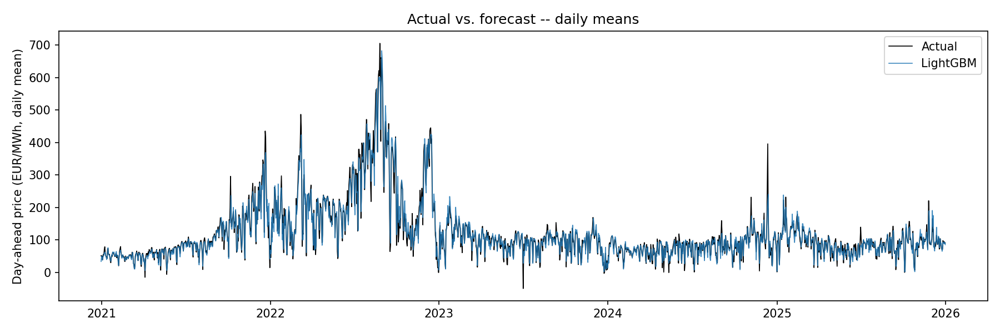
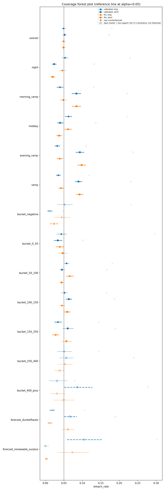
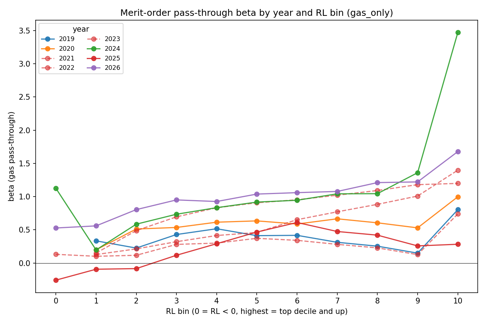
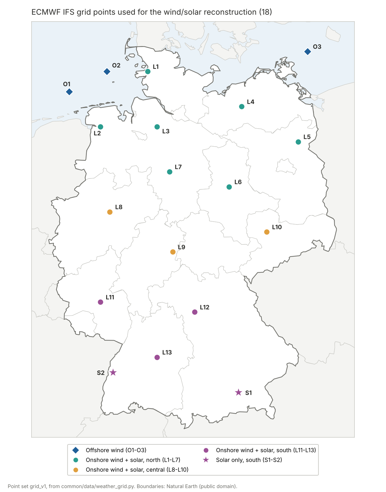

# Day-Ahead Power Price Forecasting & Risk Backtesting (DE-LU)

Probabilistic hourly price forecasts, conformal calibration, and a backtested VaR/ES for a hypothetical 10 MWh trading book, run across the 2021/22 energy crisis and the years after it.

[](https://github.com/soentkeblindow/energy-price-forecast-risk-validation/actions/workflows/ci.yml)
[](https://github.com/astral-sh/ruff)
[](https://mypy-lang.org/)
[](https://www.python.org/)
[](LICENSE)

This project forecasts German-Luxembourg day-ahead prices as full quantile distributions, then asks the question a risk function would ask: **if a desk sized its risk limits on these forecasts, would the limits have held?**

A hypothetical trading book holds a flat 10 MWh long and short position in every delivery hour from 2021 to 2025. Its Value-at-Risk and Expected Shortfall are derived from the forecasts and then backtested, the way an independent model-validation unit would test a production risk model. Every backtest uses only the information that was available at gate closure (12:00 the day before delivery).

The same hourly model, with a weather-driven wind/solar input, is submitted live every day to the [Energy Arena](https://energy-arena.org) by a separate production repository: **[day-ahead-forecast-live-ops](https://github.com/soentkeblindow/day-ahead-forecast-live-ops)**.

**Why hourly.** The German day-ahead market has traded quarter-hours only since October 2025. Calm markets in 2021, the gas crisis of 2021/22, the normalisation afterwards and the current era of negative prices exist only in hourly data. Regime-conditional risk analysis and the gas pass-through study below are only possible at hourly resolution, so the hourly model is the core of this repository.



Daily-mean actual price vs. LightGBM median forecast, 2021–2025. The crisis peak and the normalisation are both tracked.

## Risk: does the trading-book VaR hold?

One-day-ahead 95 % VaR and ES per delivery hour, for the long and the short side of the book (39,075 hours). Breach rates should be 5 %.

| Risk measure built from | Breach rate long | Breach rate short | Kupiec (unconditional) | Capital buffer vs. raw |
|---|---|---|---|---|
| Raw model quantiles | 18.0 % | 17.3 % | rejected | — |
| **Conformally calibrated quantiles** | **4.9 %** | **5.2 %** | passes (p = 0.41 / 0.13) | 1.53× / 1.72× |
| Filtered historical simulation | 4.9 % | 4.9 % | passes (p = 0.39 / 0.38) | — |

- **Raw forecast intervals are dangerously narrow.** A limit set on them would be breached more than three times as often as stated. Calibration fixes the average, at the cost of a capital buffer roughly 1.5–1.7 times larger.
- **The average is not the whole story.** Split by hour-of-day phase, forecast level and market regime, 33 of 60 cells still break coverage under a day-block bootstrap. In the evening ramp, the calibrated short-side VaR is breached 9.3 % of the time instead of 5 % (CI 8.2–10.4 %), exactly in the hours with the most exposure.
- **Breaches cluster.** They arrive in multi-day runs (cold snaps, Dunkelflauten); Christoffersen rejects independence in every validated combination.
- **Expected Shortfall** is slightly conservative on both sides (Acerbi-Szekely Z1 below zero).



Full validation, with a numbered findings catalogue in the style of a bank's model-validation report: [`model_validation_report.md`](outputs/model_validation_report.md).

## Forecast accuracy and market regimes

Walk-forward 2021–2025, rolling 90-day window, refit daily:

| Model | MAE (EUR/MWh) | RMSE | WAPE |
|---|---|---|---|
| Seasonal naive | 34.77 | 56.20 | 0.290 |
| Lasso | 22.99 | 37.03 | 0.192 |
| ARIMAX | 22.68 | 35.55 | 0.189 |
| **LightGBM (quantile)** | **14.87** | **25.64** | **0.124** |

LightGBM beats ARIMAX and Lasso by about a third. The Diebold-Mariano test (Newey-West HAC) gives p < 0.001 against both over 1,827 days. The error depends strongly on the market regime:

| LightGBM MAE by regime | Calm (early 2021) | Gas crisis (2021/22) | Post-crisis | Price spikes | Negative prices |
|---|---|---|---|---|---|
| EUR/MWh | 6.1 | 24.3 | 11.6 | 36.2 | 12.9 |

Sources: [`model_comparison.csv`](outputs/results/model_comparison.csv), [`model_comparison_by_regime.csv`](outputs/results/model_comparison_by_regime.csv), [`dm_test.csv`](outputs/results/dm_test.csv).

## Gas pass-through and the autumn-2026 live miss

In October 2026 the gas price rose to the highest level in the live model's 90-day training window, and the live forecast started to under-forecast the price level. A tree model cannot extrapolate beyond the gas prices it was trained on.

The long hourly history makes it possible to measure what the model was missing. How strongly the gas price passes through to the power price rises steadily with residual load (load minus wind and solar): from about 0.4 at negative residual load to about 2.0 when gas plants set the price. The relationship holds across 2019–2026.



Taking this term out of the tree's target is significantly better over 2019–2026 (DM p = 0.009) and neutral after the crisis. In the gas-stress hours it turns the bias from +9.4 to −4.4 EUR/MWh. It reduces the October 2026 bias but does not explain the worst days, which coincide with unusually high exports. That signal is visible only ex post, so it cannot be used as a feature yet.

Details, the error decomposition and the export diagnosis: [`autumn_2026_findings.md`](outputs/autumn_2026_findings.md). Status: candidate for the live model, not live.

<details>
<summary>More figures: fan chart, reliability diagram, dashboard</summary>


Two weeks around the highest-spread day in the test period (2024-12-12, a winter Dunkelflaute): the raw 90 % band (left) is too narrow during the spike; the calibrated band (right) widens where the raw one would have missed.


</details>

**Interactive:** [Backtest Explorer (Streamlit)](https://energy-price-forecast-azetvtdc9hgc7yylhqp84q.streamlit.app/), with forecast vs. actual, regime breakdown, and the calibration & risk views.

**How the results are kept honest:**

- Every feature is tagged with when it became known, not with the time it describes.
- Backtests are walk-forward only, with tuning nested inside.
- Calibration happens before risk, and the risk measure is itself backtested (Kupiec, Christoffersen, Acerbi-Szekely, day-block bootstrap).
- Results that complicate the story are reported as findings, including a Lasso transform that broke on an out-of-range gas price and was fixed.

## Weather model: wind and solar before gate closure

The TSOs' own wind and solar forecasts are published after gate closure, so they cannot be used in a live forecast. This model rebuilds them from the ECMWF IFS weather run of the night before; the [live-ops repository](https://github.com/soentkeblindow/day-ahead-forecast-live-ops#the-information-set-problem) explains why that matters.



**Grid points.** There are 18 of them, placed according to installed capacity:

- dense in the windy north;
- three offshore clusters;
- two extra solar points in the south (Alpine foreland and Upper Rhine).

The map is generated from the point set in code ([`plot_weather_grid.py`](scripts/model_renewables/plot_weather_grid.py)).

**Models.** Three LightGBM models (onshore wind, offshore wind, solar) predict the capacity factor on a rolling 365-day window. Two physical aggregates help the trees:

- the mean of v³, because wind power scales with the cube of wind speed;
- the share of points above rated and cut-out speed.

Turbine curves and point weights are learned, not hard-coded.

| RMSE in capacity factor, ~470 days | Persistence | Model | |
|---|---|---|---|
| Solar | 0.0332 | 0.0156 | −53 % |
| Wind onshore | 0.1353 | 0.0246 | −82 % |
| Wind offshore | 0.2147 | 0.0518 | −76 % |

**What it costs the price model.** Using the reconstruction instead of the TSO forecasts adds about 1.3 EUR/MWh RMSE. This is also the most that better weather data could win back: feeding the price model *actual* wind and solar makes it worse, because the day-ahead market prices forecasts, not outcomes.

Sources: [`renewables_backtest.csv`](outputs/results/renewables_backtest.csv), [`arena_live_gate.csv`](outputs/results/arena_live_gate.csv).

## Live model (Energy Arena)

The model submitted every day since 18 September 2026 combines three parts:

- the hourly LightGBM model above, on a 90-day window;
- the weather reconstruction;
- a shape profile that spreads each hour over its four quarter-hours.

In a quarter-hourly backtest it reaches an RMSE of 30.0 vs. 45.2 EUR/MWh for the Arena's persistence baseline. The production pipeline, fallback ladder and current leaderboard position are in **[day-ahead-forecast-live-ops](https://github.com/soentkeblindow/day-ahead-forecast-live-ops)**. Sources: [`arena_live_gate.csv`](outputs/results/arena_live_gate.csv), [`arena_bridge_backtest.csv`](outputs/results/arena_bridge_backtest.csv).

## Repository layout

```text
src/energy_price_forecast/
├── common/                        # data clients, market time / DST, metrics, DM test, conformal, LightGBM
├── model_risk_regimes/            # hourly model: baselines, ARIMAX, risk, bootstrap, regimes, dashboard
├── model_renewables/              # weather model
└── model_post_crisis_resolution/  # live model: live feature set, Arena baseline, shape profile
scripts/, tests/                   # same four-way split; tests/test_dependency_rules.py enforces imports
notebooks/                         # 01-04, hourly model
outputs/results/                   # checked-in CSVs behind every number in this README
```

## Getting started

```bash
uv sync
uv run pytest                     # or: uv run pytest tests/model_renewables
make report-assets                # regenerate the hourly-model figures from outputs/results/, no API key
make dashboard                    # Backtest Explorer locally
```

Rebuilding from raw data needs an ENTSO-E API key (`.env.example`, `make data`). Provenance of the copied weather and quarter-hourly artefacts: [`data/README.md`](data/README.md).

## Future work

- Regime-adaptive calibration, targeting the conditional coverage breaks; a ramp term in the local scale estimate.
- Gas pass-through term in the live model, with an out-of-range warning for live features.
- A lagged French price level as an admissible proxy for foreign demand.

## Data sources and license

Code: [MIT](LICENSE). Data are not redistributed:

- ENTSO-E Transparency Platform;
- Yahoo Finance (TTF gas, EUA CO₂);
- Open-Meteo / ECMWF IFS (CC BY 4.0);
- Energy-Charts / Fraunhofer ISE (CC BY 4.0);
- Natural Earth (public domain).
