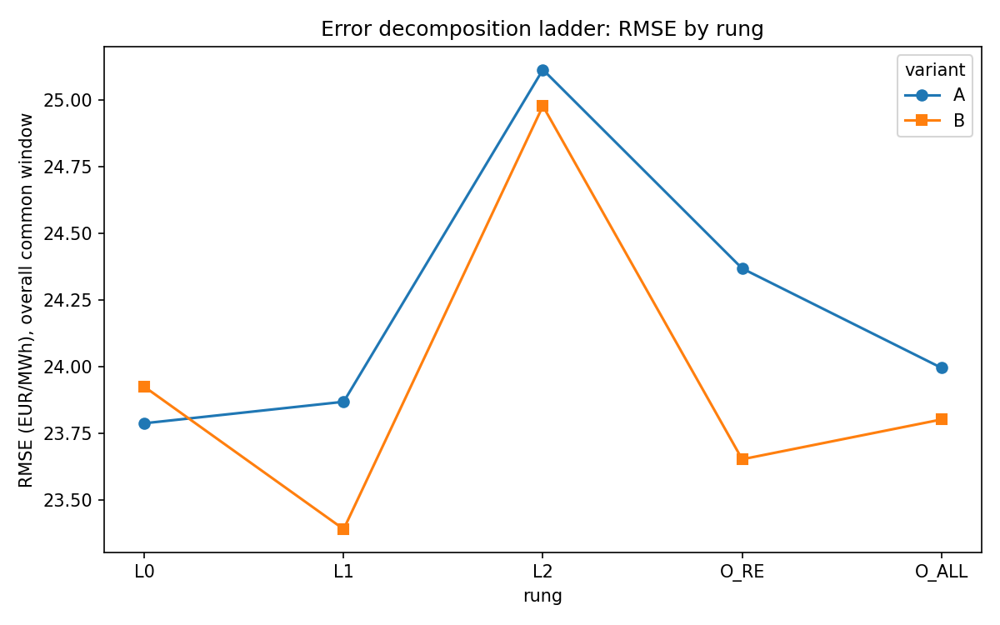
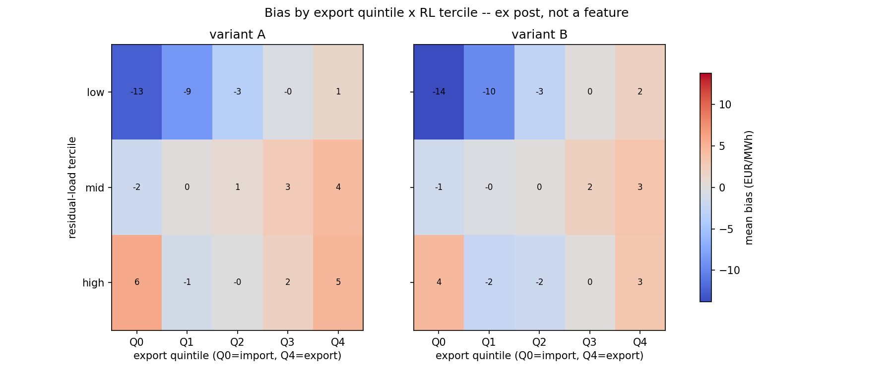

# Autumn 2026: why the live model under-forecast, and what the measurements say

Status: 2026-10-21. Research only: everything below was measured in this repository on hourly data. Nothing here has changed the live model in [`day-ahead-forecast-live-ops`](https://github.com/soentkeblindow/day-ahead-forecast-live-ops).

Sign convention throughout: **bias = actual − forecast**, so a positive bias means the model **under**-forecasts.

---

## 1. Observation

From mid-October 2026 the live quarter-hourly forecast got clearly worse. Comparing the submitted payloads with the realised prices: average daily RMSE was about 22 EUR/MWh from 1 to 10 October and about 31 EUR/MWh from 11 to 18 October. On 18 October the model was almost twice as bad as simply repeating yesterday's prices (RMSE 51.9 vs. 27.5 for the persistence baseline).

The pattern on the bad days was consistent. The model got the **shape** of the day right: night trough, midday solar dip, evening peak. It missed the **level**, under-forecasting nearly every hour. The pipeline itself was healthy throughout: the top fallback row was selected and the training window was complete. This was a model-quality problem, not a data or operations problem.

## 2. First suspect: the gas price left the training range

The TTF gas price rose from 65.8 EUR/MWh (21 Aug) to 87.6 EUR/MWh (18 Oct). On 18 October the target day's TTF value was exactly the **maximum** of the 90-day training window. A tree model (LightGBM) cannot extrapolate past the feature range it was trained on. Its forecast plateaus at the highest split, while the real price keeps moving with gas.

A longer training window would not have helped. TTF had not been above 57.8 EUR/MWh in the previous 12 months, so a 365-day window has the same ceiling, just at a lower number.

## 3. Merit-order structure: how much gas reaches the power price, and when

**Question.** Does the gas price pass through to the power price more strongly when residual load (load minus wind and solar) is high, i.e. when gas plants set the price? If so, can that structure be put into the model so the tree no longer has to extrapolate?

**Method.** For every residual-load decile bin and year (2019–2026), regress the hourly price on the short-run marginal cost of a gas plant (SRMC, from TTF). Newey-West standard errors, lag 24 h. The bin edges are frozen from 2019/2020.

**Structure: confirmed.** The pass-through factor β rises almost monotonically with residual load: from about 0.4 at negative residual load to about 2.0 in the top bin (gas-only SRMC, pooled non-crisis years). It is visible in every year, cleanest in years with a lot of gas-price movement, and it does **not** vary with the calendar month in the populated middle bins.

**Model variants** (walk-forward 2019–2026, 90-day window, daily refit, median objective):

- **A**: the current model.
- **B**: target transformation. The tree learns `price − β(RL)·SRMC` on 90 days, with β estimated on the long history (crisis excluded, capped at 1.5); the gas term is added back afterwards, so it extrapolates linearly.
- **C**: LightGBM `linear_tree`.

| Period | RMSE A | RMSE B | RMSE C | DM test B vs. A |
|---|---|---|---|---|
| Overall 2019–2026 | 22.79 | **22.05** | 66.66 | p = 0.009 (B better) |
| Post-crisis | 22.84 | 22.83 | 49.40 | p = 0.91 (neutral) |
| Stress slice: TTF at window max and residual load in upper third (1,603 h) | 32.36 | **27.17** | 127.72 | — |

In the stress slice, B turns the bias from **+9.4** (A) to **−4.4** EUR/MWh. C is significantly worse everywhere and is rejected.

Caveat: this measurement uses the full ENTSO-E feature set (TSO wind/solar forecasts that are not available at gate closure), so the levels are an **upper bound**. The ladder in section 4 repeats the A/B comparison on the live feature set.

Sources: [`merit_order_variants_metrics.csv`](results/merit_order_variants_metrics.csv), [`merit_order_variants_dm_test.csv`](results/merit_order_variants_dm_test.csv), [`merit_order_variants_oor_upper_third.csv`](results/merit_order_variants_oor_upper_third.csv), [`merit_order_beta_by_year_bin.csv`](results/merit_order_beta_by_year_bin.csv), [`merit_order_beta_by_month_bin.csv`](results/merit_order_beta_by_month_bin.csv).

## 4. Error decomposition: where does the live model lose accuracy?

**Question.** The live model differs from the research model in three ways: fewer features, reconstructed wind/solar instead of TSO forecasts, and quarter-hourly expansion. Which of these costs accuracy?

**Method.** The same hourly model is run on a "ladder" of feature sets. Each rung changes one thing. Common window 2024-06-15 to 2026-05-31 (611 delivery days). DM tests on daily blocks of squared error.

| Rung | What it uses | RMSE A | RMSE B |
|---|---|---|---|
| L0 | full feature set, TSO forecasts | 23.79 | 23.92 |
| L1 | reduced live feature set (`core_gas`), TSO forecasts | 23.87 | 23.39 |
| L2 | live feature set, wind/solar **reconstructed from weather** (what runs live) | 25.12 | 24.98 |
| O-RE | live feature set, **actual** wind/solar instead of forecasts | 24.37 | 23.65 |
| O-ALL | as O-RE, plus actual load | 24.00 | 23.80 |

| Step | Effect | DM p-value (A / B) |
|---|---|---|
| L0 → L1: feature reduction | free | 0.70 / 0.11, not significant |
| L1 → L2: weather reconstruction instead of TSO forecast | +1.1 to +1.6 EUR/MWh RMSE (~5 %) | < 0.001 / 0.002 |
| L1 → O-RE: actual instead of forecast renewables | **worse**, not better | 0.02 / 0.44 |

The last row overturned an assumption the measurement was built on. The day-ahead price is set by the market on the basis of **forecasts**. Actual outcomes are not better information about that price, just noise. So the ceiling for fundamental data is L1, the TSO forecast. A better weather run can at most close the L1 → L2 gap.

Sources: [`error_decomposition_ladder_metrics.csv`](results/error_decomposition_ladder_metrics.csv), [`error_decomposition_ladder_dm_test.csv`](results/error_decomposition_ladder_dm_test.csv), and the `_2026` variants for the January–October 2026 window.

## 5. What B does for October 2026

The hourly backtest reproduces the live error closely: the daily bias correlates at 0.95 with the live daily bias, and the sign agrees on 15 of 18 days. So the error sits in the hourly price model itself, not in the quarter-hourly bridge.

- **October 2026 monthly bias:** A **+5.0**, B **+3.2** EUR/MWh. B removes roughly a third of the systematic under-forecast.
- **The three worst days barely move:**

| Day | Bias A | Bias B | Live (quarter-hourly) |
|---|---|---|---|
| 11 Oct | +36.6 | +36.4 | +36.4 |
| 18 Oct | +34.4 | +30.8 | +46.0 |
| 19 Oct | +44.9 | +37.1 | not yet realised at the time |

B values move by about 1 EUR/MWh depending on the run's start date, because β is re-estimated every 30 days counted from the first fold.

On 18 and 19 October the "actual renewables" rung (O-RE) with B looked noticeably better. That is **not** a weather signal: the wind forecast on those two days was almost perfect (daily mean error −16 MW and −123 MW, against a typical ±681 MW). The difference comes from the differently trained model, i.e. model scatter, on two days.

**Seasonality is not the explanation either.** In calm years the bias is slightly positive in September and slightly negative in October. 2026 runs against that pattern. Autumn and winter are, however, structurally harder: relative error (WAPE) is highest in October across all years (14.7 % vs. 10.4 % in February).

Sources: [`error_decomposition_october_daily_all_rungs.csv`](results/error_decomposition_october_daily_all_rungs.csv), [`error_decomposition_seasonal_bias_by_month.csv`](results/error_decomposition_seasonal_bias_by_month.csv).

## 6. A second pattern: exports (ex post diagnosis, not a feature)

On 18 and 19 October Germany exported unusually much (4.7–5.7 GW scheduled net export instead of about 1 GW), and gas plants ran at moderate residual load. Neighbouring countries' demand is not in German residual load. So the next question was whether the model's error is systematically related to exports.

Hourly bias of A and B against scheduled net exports, April 2023 to October 2026 (31,133 hours). Borders available in the data: FR, NL, AT, PL, CH, DK1.

- At **low and medium residual load**, the bias rises monotonically with exports. The spread between strong import and strong export is 13.8 and 5.9 EUR/MWh.
- Regression slope per GW of export: +0.63 (low RL) and +0.48 (medium RL), both p < 0.001. **France alone** is stronger and positive in all three bands (+1.2 to +1.6 per GW).
- All three outlier days sit in the top export quintile of their own 90-day training window. 11 October is at the window's maximum.
- The relationship is about twice as strong from September to December as in the rest of the year.

**Caveats.** Flows and prices are determined jointly in market coupling, so this cannot prove causation. At high residual load the pattern looks like a price echo instead: Germany is short, the price rises, Germany imports. Yesterday's flows are already in the full model (L0) and the pattern still shows in its error, so lagged flows are not a usable lever.

Sources: [`export_diagnosis_expost_crosstab.csv`](results/export_diagnosis_expost_crosstab.csv), [`export_diagnosis_expost_regression.csv`](results/export_diagnosis_expost_regression.csv), [`export_diagnosis_expost_outlier_days.csv`](results/export_diagnosis_expost_outlier_days.csv), [`export_diagnosis_expost_monthly.csv`](results/export_diagnosis_expost_monthly.csv).

## 7. Where this leaves the model

| Explanation | Status |
|---|---|
| Gas clamp (TTF at the training-window maximum) | real; B removes part of it (October bias +5.0 → +3.2) |
| Foreign demand / exports | supported ex post; not usable as a feature with today's data |
| Weather / renewables forecast error | **not** the cause on the outlier days |
| Reduced live feature set | costs nothing |
| Weather reconstruction instead of TSO forecasts | costs ~5 % RMSE in general; not specific to October |
| Seasonal effect of the 90-day window | 2026 runs against the usual pattern, so not the cause |

Next steps under consideration, none decided yet:

- Port B to the live quarter-hourly model, with β re-estimated on calendar dates so results are reproducible.
- Add an early-warning flag when a live feature leaves its training range. It already exists as a tested function, `common/features/merit_order.py::ttf_out_of_range_flag`.
- Use France's lagged price level as an admissible feature (future work).

The outlier days of 11, 18 and 19 October remain unexplained in any form a model could use today.
