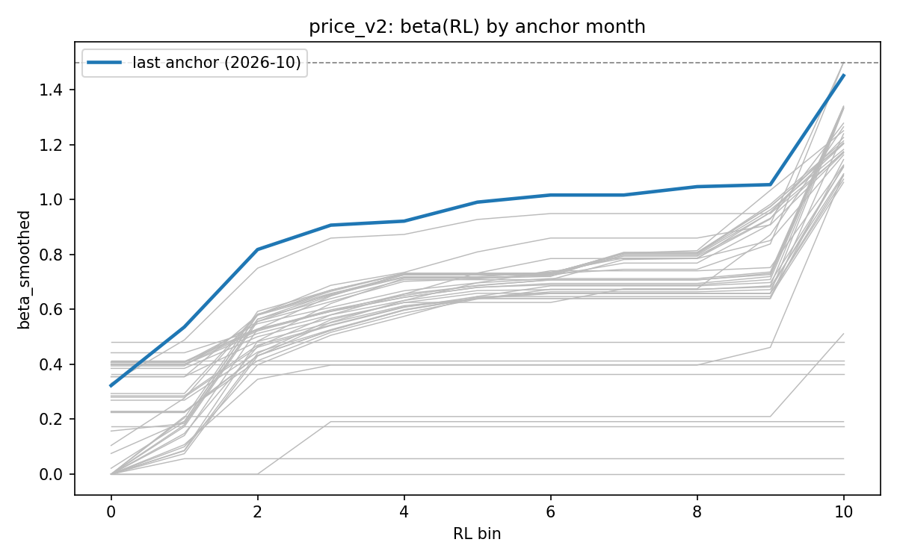

# Hourly price model: from `price_v1` to `price_v2`

Status: 2026-10-24. Research only: this is a summary of Sprint 7's
investigation, not a statement about live operation. Nothing here
implies anything is deployed in
[`day-ahead-forecast-live-ops`](https://github.com/soentkeblindow/day-ahead-forecast-live-ops).

Sign convention throughout: **bias = actual − forecast**, so a positive
bias means the model **under**-forecasts.

---

## 1. Why

From mid-October 2026 the live quarter-hourly forecast got clearly worse.
Average daily RMSE was about 22 EUR/MWh from 1-10 October and about
31 EUR/MWh from 11-18 October; on 18 October the model was almost twice
as bad as simply repeating yesterday's prices. The model got the day's
**shape** right (night trough, midday solar dip, evening peak) but missed
the **level**, under-forecasting nearly every hour. The pipeline itself
was healthy throughout — this was a model-quality problem, not a data or
operations problem.

The first suspect was the gas price. TTF rose from 65.8 EUR/MWh (21 Aug)
to 87.6 EUR/MWh (18 Oct); on 18 October the target day's TTF value was
exactly the **maximum** of the 90-day training window. A tree model
cannot extrapolate past the feature range it was trained on — its
forecast plateaus at the highest split while the real price keeps moving
with gas. A longer window would not have helped: TTF had not been above
57.8 EUR/MWh in the previous 12 months, so a 365-day window has the same
ceiling, just lower.

That observation started the investigation summarised below.

## 2. What was tested

| Study | Question | Result | Consequence for `price_v2` | Evidence |
|---|---|---|---|---|
| Merit-order structure | Does the gas pass-through strengthen with residual load (RL)? | β rises ~monotonically from ~0.4 (RL<0) to ~2.0 (top bin, gas-only SRMC) | Confirms the structure `price_v2`'s target transform is built on | [`merit_order_beta_by_year_bin.csv`](https://github.com/soentkeblindow/energy-price-forecast-risk-validation/blob/sprint7-studies/outputs/results/merit_order_beta_by_year_bin.csv) |
| Variants A/B/C | Does pulling β(RL)·SRMC out of the tree as a target transform help? | B beats A in the stress slice (RMSE 32.4→27.2, bias +9.4→−4.4); C (`linear_tree`) is far worse everywhere | B adopted as the base model | [`merit_order_variants_dm_test.csv`](https://github.com/soentkeblindow/energy-price-forecast-risk-validation/blob/sprint7-studies/outputs/results/merit_order_variants_dm_test.csv) |
| Error decomposition (incl. Oracle + objective) | What does the live feature set / weather reconstruction / objective function cost? | L0→L1 free (p=0.70/0.11); L1→L2 costs 1.1-1.6 EUR/MWh RMSE (~5%, p<0.01); **actual** renewables (Oracle) is *worse* than forecasts, not better (p=0.02); `quantile` vs `l2` not significantly different | `core_gas` (L1) feature set kept; L2 (NWP) is the live-matching reference rung, not actuals; median objective kept | [`error_decomposition_ladder_metrics.csv`](https://github.com/soentkeblindow/energy-price-forecast-risk-validation/blob/sprint7-studies/outputs/results/error_decomposition_ladder_metrics.csv) |
| Export diagnosis (ex post) | Is the error related to scheduled net exports? | Bias rises with exports at low/mid RL (p<0.001); all 3 October outlier days in the top export quintile | Real pattern, but not usable as a feature with today's data (flows/prices are jointly determined) — not implemented | [`export_diagnosis_expost_regression.csv`](https://github.com/soentkeblindow/energy-price-forecast-risk-validation/blob/sprint7-studies/outputs/results/export_diagnosis_expost_regression.csv) |
| Seasonal training window | Does adding last year's same weeks to the 90-day window help in autumn? | Sep-Nov RMSE needed to drop ≥3%; rose +3.6% (model A), dropped only 1.3% (model B) | Not adopted; 90-day rolling window kept | [`seasonal_similar_day_metrics_by_month.csv`](https://github.com/soentkeblindow/energy-price-forecast-risk-validation/blob/sprint7-studies/outputs/results/seasonal_similar_day_metrics_by_month.csv) |
| Similar-day feature | Does a holiday-adjusted "similar day" price feature reduce the Monday bias? | Needed to shrink ≥1/3; shrank only 13.6% (A) or grew 2.9% worse (B) | Not adopted | [`seasonal_similar_day_metrics.csv`](https://github.com/soentkeblindow/energy-price-forecast-risk-validation/blob/sprint7-studies/outputs/results/seasonal_similar_day_metrics.csv) |
| French day-ahead prices | Does France's price as a feature help via export/price-echo? | Both pre-registered criteria missed by a wide margin (RMSE not lower, p=0.864; export-slope reduction −5.8% vs. required −33%) | Not adopted | [`fr_price_features_assessment.csv`](https://github.com/soentkeblindow/energy-price-forecast-risk-validation/blob/sprint7-studies/outputs/results/fr_price_features_assessment.csv) |
| Calendar rule for β | Can β re-estimation be made reproducible across run start dates? | Mechanical fix (anchor to the 1st of the month instead of the run's own start); proven bitwise-identical across two runs with different start dates | Adopted — `price_v2` always re-estimates β at calendar-month boundaries | `common/models/merit_order_forecaster.py`'s own reproducibility test |
| Selection: B / B-full / B-roll | Which SRMC definition and β window? | All three statistically equivalent (no significant DM test among them) | Owner chose `B-full-roll` (gas+CO2 SRMC, 3-year rolling β window) on economic/physical grounds, not measured performance — see the model card's Configuration table for the full reasoning | [`price_v2/reference_dm_test.csv`](results/price_v2/reference_dm_test.csv) |

No study was neu gerechnet for this report; all numbers above are taken
from each study's own, already-measured result, at the configuration
named. None of the rejected studies were close to its pre-registered
criterion.

## 3. Reference results

`price_v2` (`B-full-roll`) against `price_v1` (the previous model, no
target transform), walk-forward, identical fold list, 2024-06-15 to
2026-10-20 (819 delivery days). **L2** (own weather-reconstructed
wind/solar) is the headline number — it matches the live information
state. **L1** (TSO day-ahead forecasts) is reported alongside as an
explicit **upper bound**: those forecasts are not available at gate
closure.

| Period | Metric | `price_v1` L1 (upper bound) | `price_v2` L1 (upper bound) | `price_v1` L2 | `price_v2` L2 |
|---|---|---|---|---|---|
| Overall | RMSE | 24.30 | 23.99 | 25.49 | 25.44 |
| Overall | Bias | 1.28 | 0.69 | 1.27 | 0.61 |
| Autumn/winter (Sep-Dec, all years) | RMSE | 30.75 | 30.46 | 32.01 | 31.95 |
| Autumn/winter | Bias | 1.14 | 0.40 | 1.09 | 0.19 |
| Autumn 2026 | RMSE | 29.01 | 28.30 | 30.81 | 29.46 |
| Autumn 2026 | Bias | 1.91 | −1.09 | 1.99 | −1.23 |

`price_v2` is not significantly different from `price_v1` anywhere (DM
test, squared error, daily block): L1 overall p=0.14, autumn/winter
p=0.44, autumn 2026 p=0.68; L2 overall p=0.82, autumn/winter p=0.90,
autumn 2026 p=0.33. The L1→L2 cost (TSO forecasts vs. the own weather
reconstruction) is highly significant for both versions (p<1e-6) and
matches the error-decomposition study's own 1.1-1.6 EUR/MWh range.

Full tables: [`outputs/results/price_v2/`](results/price_v2/). Source:
`scripts/model_risk_regimes/run_price_model.py` /
`build_price_beta_table.py`.

## 4. Known limitations

- In the anchor month 2023-12, β is 0 in all 11 bins: the raw per-bin
  estimates are not monotonic in residual load that month (despite
  enough observations per bin), and isotonic smoothing pulls the whole
  curve to its floor. `price_v2` was effectively untransformed that one
  month.
- In autumn 2026 specifically, `B-full-roll`'s rolling 3-year β window
  is significantly *worse* than the expanding-window alternative
  (`B-full`, daily DM p=0.028, hourly p=0.007) — the rolling window was
  chosen for its economic rationale (a non-stationary merit-order fleet),
  not because it measured better; this is the one period where that
  trade-off is visible.
- β learns a gas-price rise with roughly 1-2 months' delay (it only sees
  a price move once it enters the long-history pool); in long calm gas
  periods, β drifts back down.
- The 3-year β-window length is a set choice, not a measured one.
- The three October 2026 outlier days (11, 18, 19) remain unexplained in
  any form usable as a model feature today — the export pattern (section
  2) is suggestive but not causal, and weather-forecast error was ruled
  out directly on those two days.

See `outputs/results/model_card_hourly_price.md` for the full
configuration and its evidence.
